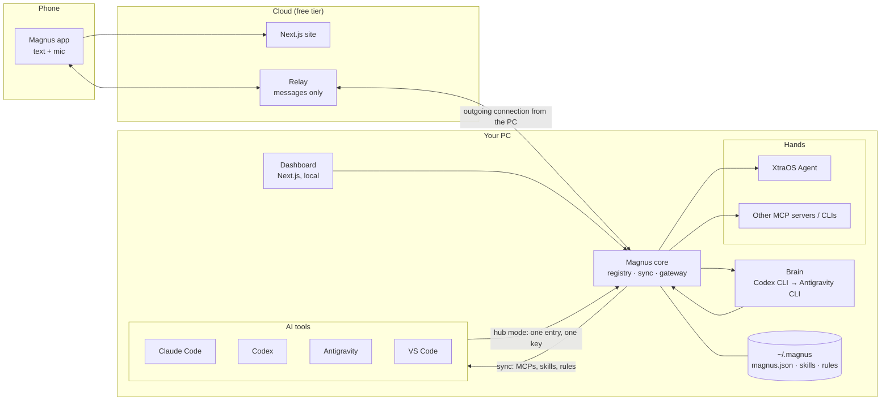
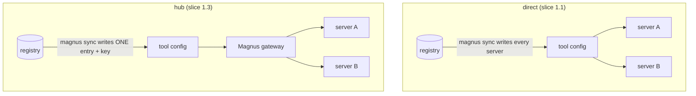
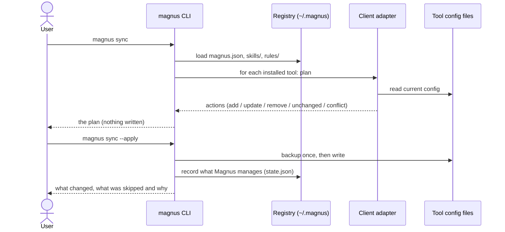
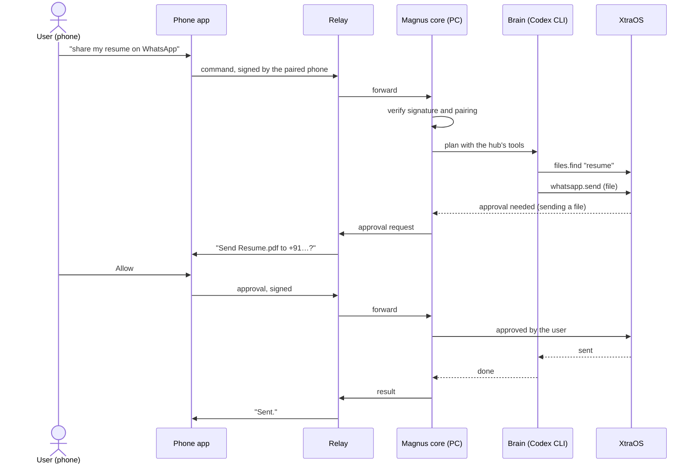
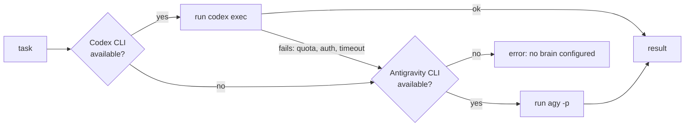

# 02 — Architecture

## Components

| Component | Package | Phase | Role |
|---|---|---|---|
| Core | `packages/core` | 1 | Registry, client adapters, sync, later the gateway |
| Dashboard / phone app | `apps/web` | 1.4, 3 | One Next.js app: local dashboard and deployed phone app |
| Brain | `packages/brain` | 2 | Runs an installed AI CLI headless with the hub connected |
| Relay | `apps/relay` | 3 | Forwards signed messages between phone and PC; stores nothing |
| Voice | `packages/voice` | 4 | Speech to text (browser on the phone, local model on the PC) |

## Two ways a tool gets its MCP servers

Direct needs nothing running and works today. Hub adds one key, one place to switch servers on
and off, a log of calls, and keeps other secrets out of the tools' config files (ADR 0002).

## Flow: `magnus sync`

## Flow: a command from the phone (phase 3)

The approval is the user's, given on a paired device and signed; the brain cannot produce it.
This flow needs an XtraOS change (remote approvals) with its own ADR in that project.

## Flow: brain fallback (phase 2)

## Boundaries
- **Core has no UI and no model.** It reads and writes files and (later) speaks MCP.
- **Adapters are data.** A tool is described by where its config lives and its format; the
  planning code is shared and pure (text in, text and actions out).
- **The relay is dumb.** It cannot read or forge commands (they are signed end to end).
- **Secrets stay on the PC**, under the user's Windows account.
